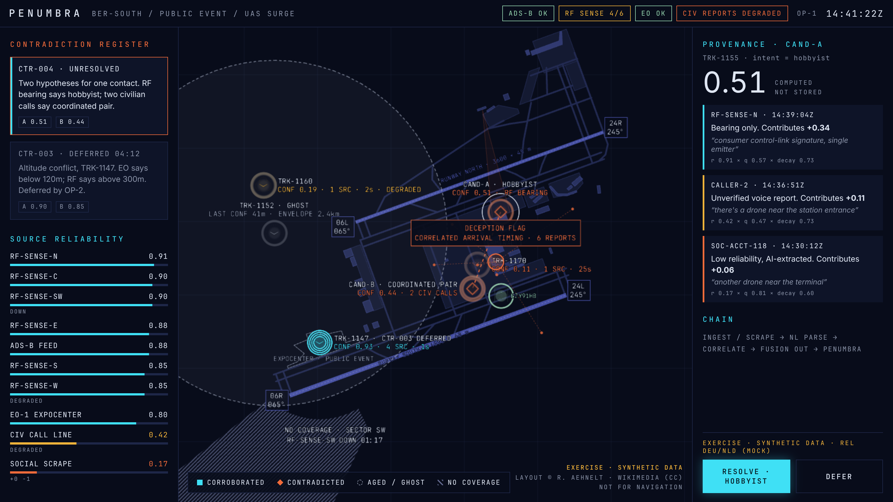

# EDDB basemap

> The second basemap, KMRB (Shepherd Field), is documented with its scenario in [KMRB-LOWCOST.md](KMRB-LOWCOST.md#basemap). Both implement the `AirportLayout` contract in `apps/client/src/map/layout.ts`; the client picks one by the scenario id the feed announces.



## Source

The airport layout is traced from **"Berlin Brandenburg Airport · Airport Layout 08/2026"** by **R. Aehnelt via Wikimedia Commons**, published under a Creative Commons licence and marked *NOT FOR OPERATIONAL USE*. The client credits it on screen ("LAYOUT © R. AEHNELT · WIKIMEDIA (CC)").

**Action before external use (DIANA submission, video, public demo):** confirm the exact licence version on the Commons file page. If it is CC BY-SA, the traced geometry in `apps/client/src/map/ber-layout.ts` is a derivative and must be shared under the same licence with attribution. The chart image itself is not stored in this repository.

## Georeference

All geometry is kept in **chart pixels** (2000 × 1414 image) exactly as traced, and converted by `pxToLatLon()`:

| | value | check |
|---|---|---|
| scale | 1,000 m = 327 px (chart scale bar) | runway north 1173 px = 3,587 m (published 3,600); runway south 1310 px = 4,006 m (4,000); separation 624 px = 1,909 m (≈ 1,900) |
| rotation | chart +x axis = true bearing 070° | north arrow ≈ 20° east of up; runways 065° magnetic + ≈ 5° east declination |
| anchor | chart ARP N 52°22′00″ E 13°30′12″ at the midpoint of the runway centres | |

Runway designators follow the chart: **06L/24R** (north, 3,600 × 45 m) and **06R/24L** (south, 4,000 × 60 m), headings 065°/245°.

## What is traced

Both runways with designator boxes; taxiways A, B, C, D, E, T, P, V, L1–L8, M1–M9, K, K1–K6, G, H, N1, F, Y1; aprons (Ramps A–E, maintenance, cargo, Ramp 4/GA, Ramps 1, 2, 3, 3b); Terminals 1, 2 and 5 (closed); tower, ACC, hangars, fire stations, government terminal, express cargo, cargo, GAT, business aviation, fuel depot, multi-storey car parks; the ExpoCenter grounds (dashed). Labels are graded by zoom: major names always, runway names from z12.5, facilities from z14.2, taxiway letters from z14.8.

**Verification:** the traced geometry was overlaid on the source chart; runways coincide exactly, and exits, aprons and buildings sit on their chart counterparts. To repeat:

```bash
npx tsx apps/client/scripts/trace-overlay.ts > trace.json
python3 apps/client/scripts/trace-overlay.py chart.webp trace.json overlay.png
```

## Scenario geography on the real layout

| Element | Placement |
|---|---|
| Public event | ExpoCenter (south-west, by the 06R end); camera EO-1 there |
| TRK-1147 (corroborated, CTR-003) | loitering over the ExpoCenter event |
| TRK-1155 CAND-A (RF bearing) / CAND-B (civil calls) | Ramp A, north of Terminal 2 / the Terminal 1 car parks |
| TRK-1170 swarm burst | over Terminal 1 |
| TRK-1152 ghost, TRK-1160 faint contact | west and north-west of the 06L threshold |
| DLH4KT | departs 24R, straight out on 245 |
| EZY91HB | lands 24L, rolls out, exits via M7, taxis to Ramp C |
| RF sensors (2.5–4.3 km range) | N by Fire Station North (RF shadow behind Terminal 1), C on the tower, S south of 24L, W west of 06L (degraded), E by business aviation, SW beyond 06R |
| Blind sector | when RF-SENSE-SW fails, coverage is lost from ≈ 2.5 km south-west of the ARP, beside the 06R threshold |

A new test checks that **every sensor report lies inside that sensor's footprint**, so no sensor sees where its coverage says it can't. All slide 7 numbers are unchanged (CAND-A 0.51 = +0.34 / +0.11 / +0.06, CAND-B 0.44, TRK-1147 0.93 · 4 SRC, CTR-003 deferred 04:12, RF 4/6, deception flag on 6 reports).
