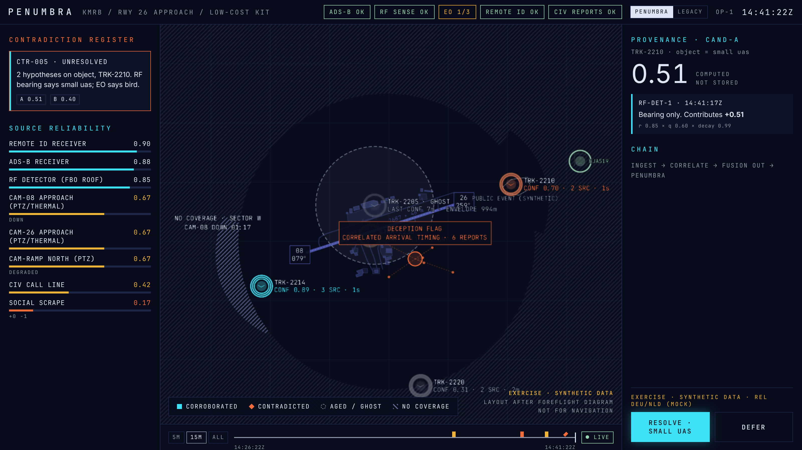
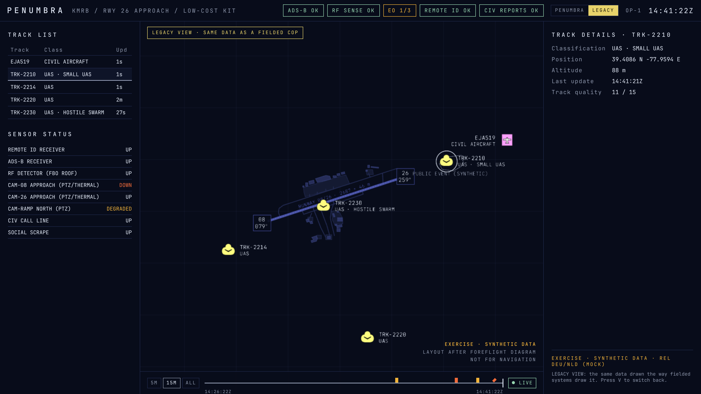
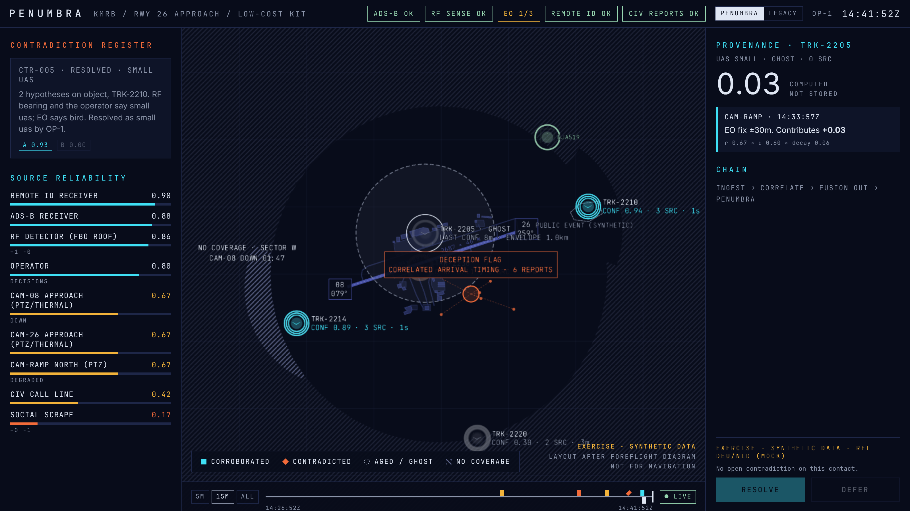

# KMRB low-cost scenario



A second scenario for the same question the BER scenario asks, at the other end of the market: **a regional airport that cannot afford a sensor network**. Eastern WV Regional / Shepherd Field (KMRB), one 2,687 m runway, a GA/FBO side, a business jet on approach and a public event under the runway 26 approach. The airport has bought a commercial off-the-shelf kit and nothing else.

The question for the pitch: **does the confidence layer keep the picture honest when the sensors are cheap and few?** If PENUMBRA only helps where a radar-and-RF network already exists, the addressable market is a handful of hub airports. If it makes a cheap kit trustworthy, it's every regional airport, stadium and critical site.

```bash
pnpm frame --scenario mrb               # text picture at the key frame
pnpm feed --scenario mrb                # live feed (then pnpm client)
pnpm demo:record -- --scenario mrb      # scripted demo video
PROBE_SCENARIO=mrb pnpm probe:smoke     # automated probe run
```

In the browser, offline: `/?scenario=mrb`, `/?scenario=mrb&t=14:41:22`, `/?scenario=mrb&probe`, `/?scenario=mrb&demo`. A live feed plays whatever the server was started with; the client picks the basemap and demo script from the scenario id the feed announces.

## The kit

| Sensor | Model in the scenario | What it cannot do |
|---|---|---|
| 1 passive RF detector (FBO roof) | `RF-DET-1`, reliability 0.85, 2.5 km, **bearing only** | no range from one antenna; deaf to drones with no control link (autonomous flight) |
| 2 approach cameras (PTZ/thermal) | `CAM-26`, `CAM-08`, 0.67, 1.5 km sectors along the extended centreline | short range; the commercial classifier confuses birds and drones; network-dependent |
| 1 ramp camera (PTZ) | `CAM-RAMP`, 0.67, 600 m sector looking south over the north ramp | blind behind its mast; degraded by sun glare |
| Remote ID receiver | `RID-RX`, new source type `REMOTE_ID`, 0.90, 2.5 km | sees only drones that choose to broadcast; positions are self-reported and spoofable. Counts as **cooperative** coverage, never drone coverage |
| ADS-B receiver | `ADS-B-RX` | cooperative aircraft only |
| Public call line, social scrape | as at BER | |

No radar. Same window as BER (play from 14:38:22, key frame **14:41:22**, end 14:41:52), so the legibility probe asks the same questions at the same moments.

## Story

| Time | What happens | What it demonstrates |
|---|---|---|
| history | a compliant hobby drone south-west of the 08 approach broadcasts Remote ID; CAM-08 and an RF bearing agree (TRK-2214, 3 sources, ≈ 0.9) | a cheap kit can corroborate |
| 14:33 | an autonomous drone crosses the north ramp, seen only by CAM-RAMP, and leaves under the mast (TRK-2205). RF never hears it | **covered is not seen**: the ghost's envelope grows inside ground the map calls covered |
| 14:37 | CAM-26 tracks an object over the event, 1 km out on the 26 approach; its classifier says **bird** | |
| 14:38:40 | callers report a drone over houses 3 km south, beyond every drone sensor (TRK-2220) | blind ground drawn as blind, not empty |
| 14:39:00 | RF-DET-1 hears a drone control link on that bearing: **CTR-005** opens, small-uas 0.51 vs bird 0.40 | the decision that matters, with neither reading averaged away |
| 14:40:05 | CAM-08 drops off the network | lost coverage (W sector) vs never-covered ground |
| 14:40:20 | six social accounts post a "swarm" over the T-hangars within 30 s | deception flag, one vote, over ground the RF detector covers and hears empty |
| 14:41:22 | **key frame**: business jet EJA519 2.2 km out, about 17 s from the contact | |
| 14:41:26 | the tower sees the drone with binoculars (verification) | |
| 14:41:30 | OP-1 resolves CTR-005 as a drone; the jet breaks off (scripted ADS-B track) | |
| after | CAM-26 keeps saying bird every 2 s, and CTR-005 **stays resolved** | see the engine change below |

Interactive play (default offline, or `pnpm feed --scenario mrb --manual`) leaves the decision to the operator.

### PENUMBRA vs LEGACY at the key frame



The low-cost case makes the comparison sharper than BER does. LEGACY draws the six fake posts as a `UAS · HOSTILE SWARM` track on the runway, with the same symbol and weight as the real drone on the approach. The autonomous drone has silently disappeared (track-drop timer), and nothing shows that the 08 approach camera is down. PENUMBRA shows the same data as flagged and one vote, as a growing ghost, and as a lost sector.



## Engine changes this scenario forced

Both are general fixes, not scenario special cases. BER's golden key frame is unchanged.

1. **A bearing-only fix no longer displaces a recent precise fix** (`packages/core/src/project.ts`). The entity position was the latest fix, so every 6 s an RF bearing (±300 m) replaced the camera fix from 2 s earlier (±30 m). The contact jumped, and the view split it into candidates on alternate frames. Now the bearing wins only if its uncertainty, grown to now, is smaller than the latest precise fix's. Tested by "never splits TRK-2210" over the whole playback.
2. **Reopen rule: "fresh" evidence means a new origin** (`M1-DESIGN.md` §contradictions, item 4). A camera classifier repeating "bird" after the operator overruled it reopened CTR-005 within 2 s. With a cheap kit, that would undo every decision. Now only an origin that had not asserted the rejected value before the decision can reopen it. BER's case, a third caller arriving after an early resolution, still reopens.

## Comparing BER and KMRB with the probe

Every probe answer now carries `scenario`. `pnpm probe:report` keeps one participant's BER and KMRB answers apart and adds a scenario × view table when both are present. Answers recorded before this field existed count as BER. Suggested protocol: each participant takes the probe on both scenarios, order counterbalanced. Report accuracy and median time per view per scenario. The claim to test is that the PENUMBRA/LEGACY gap is at least as large on the low-cost kit as on the full network.

## Basemap

Traced from the KMRB FBO airport diagram (MRB Aviation; base chart © 2016 ForeFlight LLC) into `apps/client/src/map/mrb-layout.ts`. The chart image is not in the repository. Georeference:

| | value | check |
|---|---|---|
| scale | runway 08/26 = 8,815 ft = 2,687 m over 1,469 chart px → 1.83 m/px | test: traced runway measures 2,687 m |
| rotation | chart is true-north-up (vertical arrow true, tilted arrow magnetic, VAR 8° W) | runway measures 072° true; 079° magnetic − 8° W ≈ 071° |
| anchor | ARP N 39°24′07″ W 077°59′05″ at the runway midpoint | **approximate**: verify against the FAA 5010 record before external use |

Traced: the runway; taxiways A (with the west loop and A1), the north-ramp connectors, E/E1/E4, B, C, D and the west complex link; the north ramp and its hangars, the north-east site, the west complex, the FBO terminal and apron, the east complex and T-hangars, and the south and south-west hangars. The public event outline is **synthetic** (not on the chart), placed about 1 km out under the 26 approach. The trace was checked by rendering it in chart pixels against the diagram; there's no automated overlay because the image isn't stored.

**Before any external use** (DIANA submission, video, public demo): the base chart is ForeFlight's copyright. Clear the use with MRB Aviation/ForeFlight, or re-trace the layout from a public-domain source: FAA airport diagrams are US government works.

## Limits

- All events, callsigns, sensors, callers and accounts are invented. Only the layout is real.
- Sensor numbers (reliabilities, ranges) are plausible commercial figures, not measured on any product.
- The RF detector is modelled as single-antenna bearing-only; many commercial detectors give a coarse range or use two antennas, which would make the picture better than shown.
