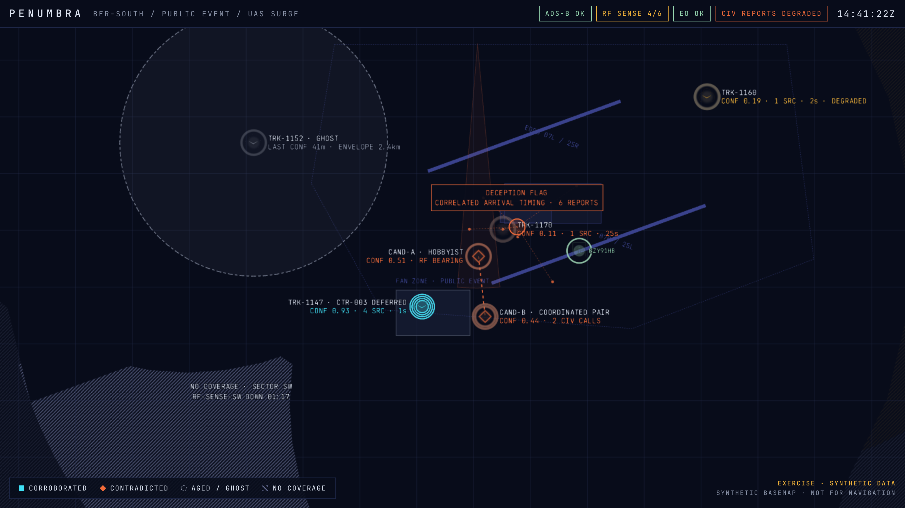
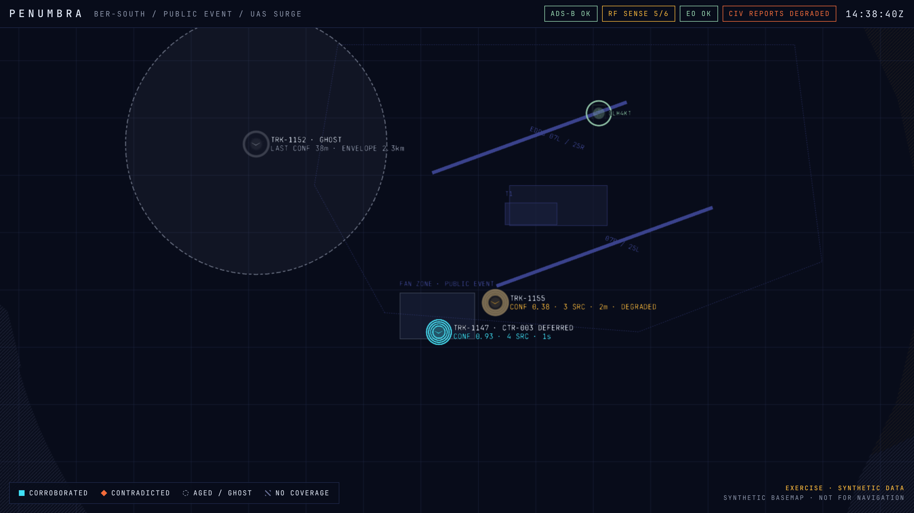
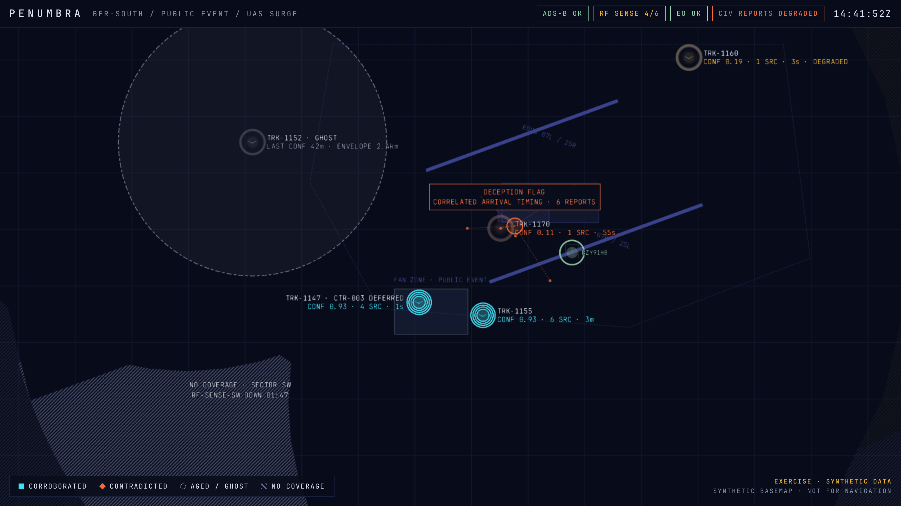

# PENUMBRA Phase 0 · M2 notes: map rendering

M2 scope from the [brief](../PHASE0_PROTOTYPE_BRIEF.md): map rendering of the four conditions plus the deception flag. The client is `apps/client` (Vite, React, deck.gl).

| Frame | |
|---|---|
|  | **14:41:22Z, the slide 7 key frame.** |
|  | **14:38:40Z.** Before the RF reading arrives: no CTR-004 yet, RF 5/6, the SW sector still covered. |
|  | **14:41:52Z.** After OP-1 resolves CTR-004: the candidates collapse into one cyan track at 0.93. |

Regenerate with `pnpm shot` (or `pnpm shot -- --t 14:39:30 --out docs/screens/x.png`).

## How each condition is drawn

| Condition | Encoding | Where |
|---|---|---|
| Confidence as a continuous property | Custom GPU layer: **ring density** = independent sources (1–4), **edge sharpness** blurs as confidence falls, **saturation** washes to grey; symbol opacity follows confidence | `map/ConfidenceRingLayer.ts` |
| Ghost with expanding envelope | Dashed **plausible envelope** (random-walk model) plus a faint dotted **hard-reach ring**; dashed APP-6 frame (status "anticipated"); "LAST CONF 41m · ENVELOPE 2.4km" | `model/view.ts` |
| Two live hypotheses | For a contact whose position is itself uncertain (fix σ ≥ 150 m), each hypothesis is a hollow orange diamond at its own position, linked, labelled "CAND-A · HOBBYIST / CONF 0.51 · RF BEARING". A well-tracked contact keeps one track and carries the contradiction as a tag ("TRK-1147 · CTR-003 DEFERRED"). | `model/view.ts` |
| Where the picture cannot see | Exact vector coverage: faint hatch where no sensor has ever looked, dense hatch where a sensor is down, amber tint where only degraded sensors see, plain ground where coverage is live. Labelled "NO COVERAGE · SECTOR SW / RF-SENSE-SW DOWN 01:17". | `map/layers.ts` (`coverageLayers`) |
| Deception flag | Orange marker at the burst centroid, spokes to each report, boxed label | `model/view.ts`, `map/layers.ts` |
| Bearing-only reports | A wedge from the sensor (bearing ± 2σ), not a point | `model/view.ts` |

Colour logic: cyan = corroborated (≥ 2 sources, ≥ 0.6); orange = an *unresolved* contradiction or a deception flag; amber = top source degraded; grey = ghost or single weak source; green = cooperative civil traffic (ADS-B), labelled small so it reads as context. A *deferred* contradiction does not turn a track orange: the operator has parked it. This matches TRK-1147 on slide 7.

Symbols are standard APP-6 / 2525 (milsymbol, monochrome outline). PENUMBRA modulates them; it doesn't replace them.

## Architecture

- **The client evaluates locally.** It receives the full log over the WebSocket, keeps its own `Projector`, and re-evaluates at 10 Hz (`?evalHz=`) at an extrapolated head. Confidence decays and envelopes grow continuously, not in server-snapshot steps, and the M4 scrubber needs no round trip.
- **Offline mode.** The same scenario compiles and plays in the browser, used when no feed server is reachable, or forced with `?mode=offline`. `?t=14:41:22` freezes a moment for screenshots and briefings.
- **Layer groups with different lifetimes.** Basemap (once), coverage (on a status change or zoom step), picture (every tick). A tick costs about 1.3 ms of JS for the reference scenario.
- **Label decluttering.** Greedy screen-space placement (right / left / above / below), avoiding glyphs, the flag box and screen edges. A low-priority label with no room is hidden and shown on hover. Contradicted and flagged labels always show.
- **No MapLibre (deviation from the brief).** With no tile server allowed in Phase 0, MapLibre would render an empty map. The basemap is a handful of synthetic deck.gl shapes (runways, terminal, fan zone, 1 km grid), marked "SYNTHETIC BASEMAP · NOT FOR NAVIGATION". Add MapLibre when accredited offline tiles are provisioned. Nothing else changes.

## URL parameters

`?mode=offline` · `?t=HH:MM:SS` (freeze) · `?speed=4` · `?ws=ws://host/ws` · `?evalHz=10` · `?stress=500` (adds N synthetic three-source drones) · `?stats` (fps meter and per-tick timings)

## Verification

- `pnpm test`: 99 tests, including the client render model (slide 7 labels and categories, the TRK-1147 never-split rule, collapse after resolution), the coverage mask, feed chips, and label placement.
- `pnpm smoke`: real feed server + Vite proxy + headless Chromium. Checks the client goes live, the log grows, and the display follows the head.
- `pnpm shot`: screenshots above.

## Performance (measured here: CPU only, no GPU)

| | entities | evaluate | render model | layers |
|---|---|---|---|---|
| reference scenario | 8 | 0.5 ms | 0.6 ms | 0.2 ms |
| `?stress=500` | 507 | 26–33 ms | 2.3 ms | 1.1 ms |

At 10 Hz evaluation, 500 entities use about a third of the main thread for evaluation. **The 60 fps criterion is not verified.** This container renders WebGL in software (about 3 fps for any scene), so frame rate has to be measured on a real laptop: open `?stress=500&stats&speed=4` and read the fps meter *while playing*. If evaluation turns out to be the bottleneck, move the `Projector` into a Web Worker (it has no DOM dependencies).

## Open items for M3+

1. Panels (contradiction register, source reliability, provenance, RESOLVE/DEFER): M3. The tooltip already shows a contribution breakdown on hover.
2. At high density, labels hide correctly but glyphs still overlap; clustering is out of scope for Phase 0.
3. Bundle is 534 kB gzipped (deck.gl + milsymbol). Fine for a prototype; code-split if load time matters for evaluators.
