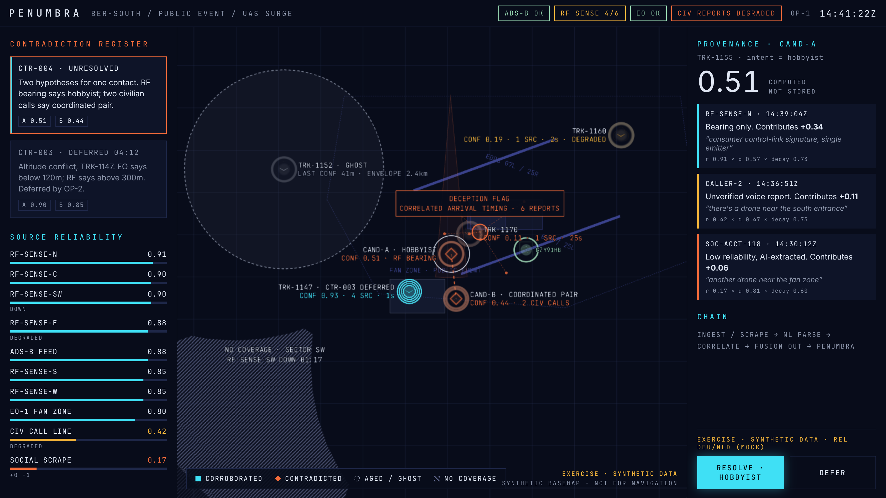

# PENUMBRA Phase 0 · M3 notes: panels and RESOLVE / DEFER

M3 scope from the [brief](../PHASE0_PROTOTYPE_BRIEF.md): the slide 7 panels and the operator actions. With M3 the target screen is complete.

## What's on screen

**Left: contradiction register.** Newest first. Each card has the id, a live status (`UNRESOLVED`, `DEFERRED 04:12` counting up, `RESOLVED · HOBBYIST`, `REOPENED`, `LAPSED`) and a generated sentence, e.g. *"Two hypotheses for one contact. RF bearing says hobbyist; two civilian calls say coordinated pair."* Chips show each candidate's confidence, accepted ones highlighted and rejected ones struck through. Clicking a card selects its leading candidate.

**Left: source reliability.** Every source's Beta-posterior reliability, cyan ≥ 0.75, amber ≥ 0.4, orange below, with status (`DOWN`, `DEGRADED`) and verdict counts (`+0 −1`). Once an operator has resolved something, the virtual `OPERATOR` source appears here too: decisions are evidence, so they get a reliability like everything else.

**Right: provenance.** For the selected contact or candidate:
- the big confidence number, *computed, not stored*
- one card per contributing origin, left edge coloured by source type, with a plain-language line ("Bearing only.", "Unverified voice report.", "Low reliability, AI-extracted.", "Verified by POLICE-UNIT-7.", "Operator decision.", "One vote for 6 coordinated accounts"), the rounded share ("Contributes +0.34"; the shares add up on screen), the original report text, and the `r × q × decay` factors
- the processing **chain**, merged across contributions; alternatives are shown together: `INGEST / SCRAPE → NL PARSE → CORRELATE → FUSION OUT → PENUMBRA`
- the mock releasability marking `EXERCISE · SYNTHETIC DATA · REL DEU/NLD (MOCK)`
- **RESOLVE · <value>** and **DEFER**

**Selection.** Click a glyph on the map or a register card; the selection is ringed on the map. Until the operator picks something, the panel follows the newest open contradiction's CAND-A (the slide 7 state). If a selected candidate is rejected, the selection falls back to its contact.

## Operator actions

| | RESOLVE | DEFER |
|---|---|---|
| Available when | a candidate of an unresolved or deferred contradiction is selected | the contradiction is unresolved |
| Effect (per the M1 review decisions) | operator vote for the accepted value; rejected value to zero; reopens on fresh contrary evidence | none on confidence; status and timer only |
| Keyboard | `R` | `D` |

- **One rule set.** `validateOperatorAction` (core) is used by the server and by the offline player, so both refuse the same things with the same reasons ("CTR-004 is already resolved").
- **Live mode:** the client sends `operator_action` with a request id and waits for the server's ack. The event lands in the server's append-only log (`/log.jsonl`) and reaches every client.
- **Offline mode:** validated and appended locally at the head. Sequence numbers are assigned in publication order, as on the server.
- **Interactive by default.** `pnpm dev` runs the feed with `--manual`, and the offline player drops scripted decisions from playback onwards. Decisions in the history (OP-2 deferring CTR-003 at 14:37:10) are kept, so the key frame is unchanged. `?scripted` (offline) or `pnpm feed` without `--manual` plays the scripted ending for unattended demos.
- **Operator id:** `?op=OP-3` (default `OP-1`), shown in the header.

## Verification

- `pnpm test`: 119 tests. New ones cover the register sentences and statuses at the key frame and after resolution, source tones, CAND-A provenance rows and chain exactly as on slide 7, action availability (deferred can be resolved, not re-deferred), the selection fallback, on-screen rounding, the burst description, and offline actions through the real store (valid / invalid / sequence order, interactive-by-default).
- `pnpm smoke`: live feed + browser. CTR-004 appears, provenance opens on CAND-A, **clicking RESOLVE · HOBBYIST resolves CTR-004**, the confirmation shows, the server log records OP-1's decision, and `D` is refused afterwards.

## Layout

The panels are 320 px and 360 px around the map, narrowing at < 1180 px. Below 900 px they stack in the order map, provenance and actions, register, with no horizontal scroll. It's usable on a phone, but this is a desktop operator tool.

## Open items for M4+

1. M4: time scrubber (the client already holds the full log and projects locally) and the LEGACY toggle.
2. Notes on decisions (a free-text reason with RESOLVE / DEFER) would feed M5's decision-quality analytics; small addition to the `operator_action` event.
3. Undo is deliberately absent: the log is append-only. A "reopen" action is the honest equivalent if evaluators ask for it.
