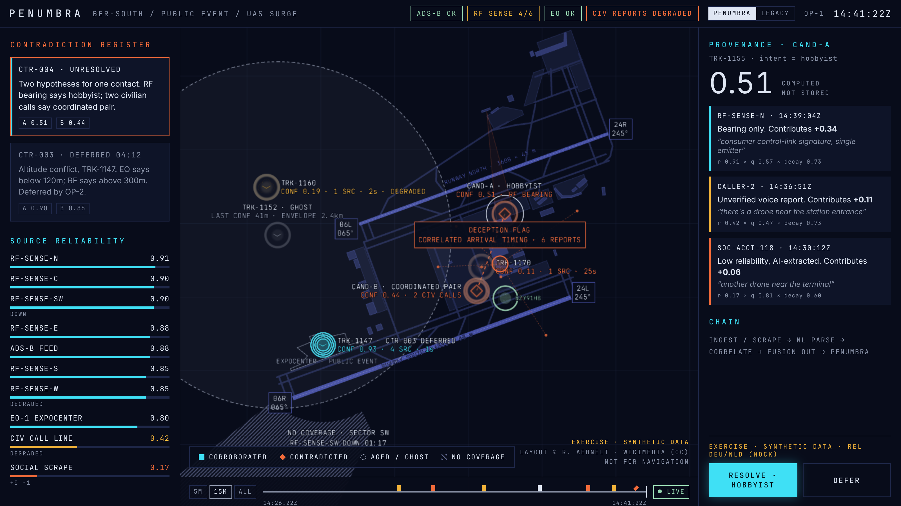
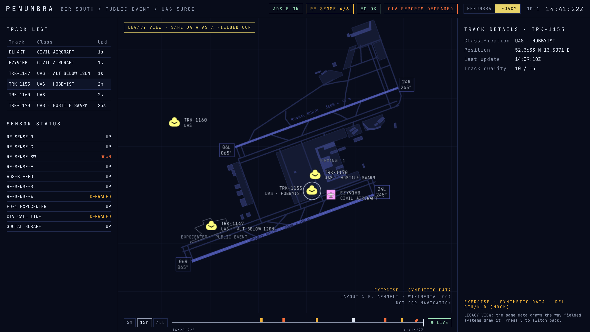
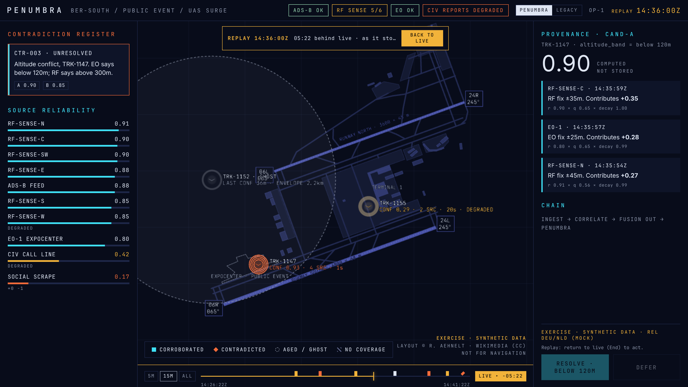

# PENUMBRA Phase 0 · M4 notes: time scrubber and LEGACY toggle

M4 scope from the [brief](../PHASE0_PROTOTYPE_BRIEF.md): reconstruct the picture exactly as it appeared at any past moment, including operator actions, and a LEGACY toggle drawing the same data the way fielded COPs do, as a fair copy, not a strawman.

| PENUMBRA, 14:41:22 | LEGACY, same moment, same data |
|---|---|
|  |  |

**Replay, 14:36:00, seen from a 14:41:22 head:**

## Time scrubber

- **Timeline** along the bottom of the map. Drag anywhere to replay; the right edge is the live head. Windows: 5 min, 15 min, all.
- **Marks** for the moments worth jumping back to: contradictions opening (orange), operator decisions (white), sensor status changes (amber), verdicts (cyan), deception flags (orange diamond). Hover for the label, click to jump. Marks that would overlap are stacked in two lanes so each stays clickable.
- **Exact reconstruction.** The client holds the full append-only log, and a replay projector rebuilds the picture at the chosen moment. Events after that moment, including later decisions, are not seen. In the 14:36 replay CTR-003 is still *unresolved* (OP-2 deferred it at 14:37:10), RF reads 5/6 (RF-SENSE-SW fails at 14:40:05), and CTR-004 does not exist yet. A property test checks that replay always equals a from-scratch `project(log, t)`, scrubbing forwards and backwards.
- **Unmistakable replay mode:** an amber banner ("REPLAY 14:36:00Z · 05:22 behind live"), an amber clock tagged REPLAY, an amber timeline, and RESOLVE / DEFER disabled ("Replay: return to live (End) to act"). Playback continues underneath.
- **Keys:** ← / → step 5 s (Shift: 1 min); End or Esc returns to live. `?replay=14:36:00` opens on a moment.
- **Cost:** stepping forward is incremental; stepping back rebuilds from the log. That's about 2–3 ms for the reference scenario. For long, dense logs (≈ 1.8 µs per event) add projector checkpoints; noted for later.

## LEGACY view

Press **V** or use the header switch. The same snapshot, drawn by rules a fielded COP actually follows:

| Fielded behaviour | In LEGACY |
|---|---|
| One fused track per contact | one symbol at the last fused position; CAND-A / CAND-B become a single TRK-1155 |
| Fusion resolves conflicts to a best estimate | classification = highest-scoring reading ("UAS · HOBBYIST"); the competing one vanishes, no contradiction register |
| Standard symbology, uniform | APP-6 / 2525 symbols in standard colours, one size, regardless of confidence (TRK-1160 at 0.19 looks like TRK-1147 at 0.93) |
| Coasting tracks look current until dropped | no ageing; tracks drop after 300 s without an update (TRK-1152 is simply gone) |
| No coverage model on the picture | no blind sector, no shadows |
| No deception adjudication | the planted posts appear as an ordinary "UAS · HOSTILE SWARM" track |
| Track quality exists, as metadata | "Track quality 14 / 15" in the track details panel on selection, not on the map |

Panels switch to what fielded systems show: a **track list** (track, class, last update), **sensor status** (up/degraded/down, no reliability) and **track details**.

Why it's fair: nothing is hidden that a fielded system would show, and nothing is added that it would not. The difference evaluators see is the deck's claim: the information exists in both, but only PENUMBRA puts confidence, age, contradiction, coverage and coordination *on the picture*. M5's legibility probe will measure that difference.

## Verification

- `pnpm test`: 130 tests. New ones cover replay = from-scratch projection (property, both directions), replay not seeing later decisions, replay staying correct as the live log grows, the LEGACY rules (one track per contact, silent best-reading resolution, uniform symbol, drop timer with no ageing before it, planted swarm as an ordinary track, track quality), timeline marks, and mark lanes.
- `pnpm smoke` (21 checks, live server, headless browser) now also: pauses, clicks the "CTR-004 opened" mark, checks the replay shows CTR-004 *unresolved* with actions disabled, returns to live with End, switches to LEGACY with V (track list, one fused track, track quality in details), and back.

## Found along the way

The smoke test caught the **reopen rule** from the M1 review in action. If OP-1 resolves CTR-004 before 14:39:10, the third civilian call ("two of them, one following the other") arrives after the decision, and CTR-004 correctly reopens. It's a good demo moment: resolve early and the system tells you new evidence disagrees.

## Open items for M5

1. Legibility probe in both views: freeze a frame, ask which contact is least reliable, where we cannot see, which track is stale; record answer and latency.
2. Session instrumentation (JSONL of every interaction) and the demo / capture mode.
3. Replay checkpoints for long logs; mark clustering when many marks share a lane.
