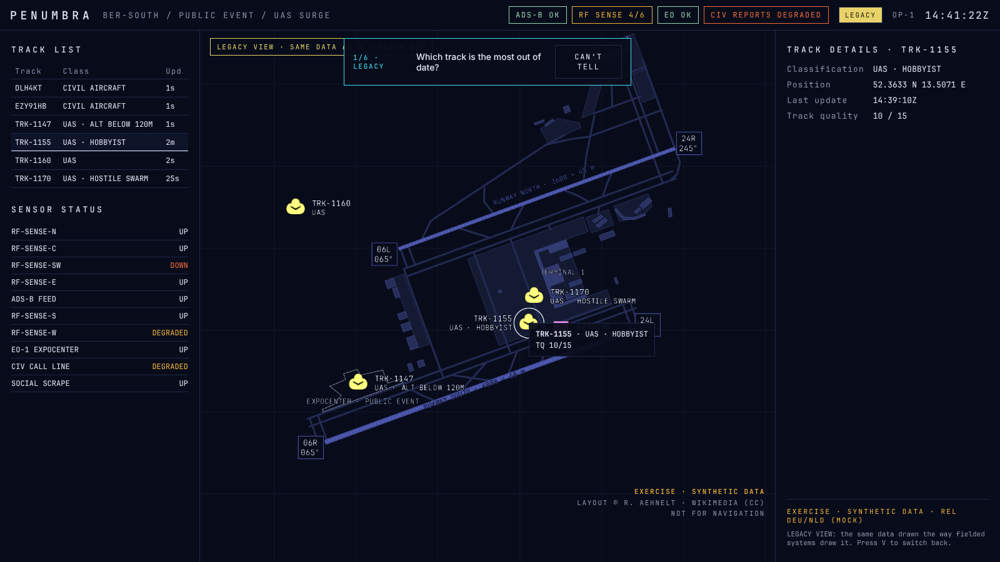
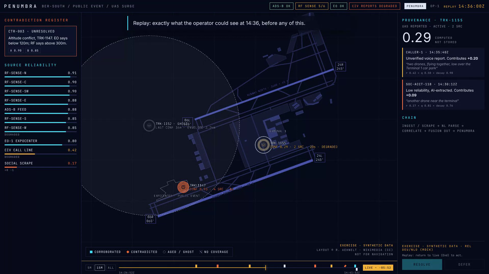

# PENUMBRA Phase 0 · M5 notes: instrumentation, legibility probe, demo mode

M5 scope from the [brief](../PHASE0_PROTOTYPE_BRIEF.md): every operator interaction logged to JSONL; a legibility probe comparing PENUMBRA and LEGACY; a scripted demo with a 1080p capture mode. With M5, Phase 0 is feature-complete.

## 1. Session instrumentation

Every interaction is recorded with wall-clock time, monotonic milliseconds, the simulation time on screen, the view and whether it was a replay:

`session_start` · `select` (with where it came from: map, register, track list, demo) · `action_request` / `action_result` (resolve/defer, outcome, error) · `view` · `replay` / `replay_move` / `live` · `control` (play, pause, speed, restart) · `probe_*` · `demo_cue`

- **Live:** batched every 2 s to the feed server, `POST /api/sessions/<id>`, stored as `sessions/<id>.jsonl` (git-ignored; `--sessions-dir` to change, `--no-sessions` to disable). `GET /api/sessions` lists them. Session ids are strictly validated, every line must be a JSON object, batches are capped at 1 MB.
- **Offline:** kept in the browser and offered as a download.
- Together with the server's append-only picture log (`/log.jsonl`), this is the raw material for M5+ decision-quality analytics: what the operator saw (replayable exactly) against what they did and when.

## 2. Legibility probe

Open **`/?probe`** (with `pnpm dev` running, answers are also stored on the server).



**Protocol**

- Six trials: three questions from the brief in each view. *Which contact is the least reliable? Where can we not see drones? Which track is the most out of date?*
- Answered by clicking the map (or "Can't tell"). Time is measured from the moment the frame is painted.
- **No carry-over:** each participant sees PENUMBRA and LEGACY at **different moments** (14:41:22 and 14:40:55: same kind of picture, different details).
- **Counterbalanced** by participant id: which view comes first, and which moment goes with which view.
- **Right answers are computed from the engine's own picture** for the view being shown, never typed in:

| Question | Correct if… | 14:41:22 PENUMBRA / LEGACY |
|---|---|---|
| least reliable | the contact's confidence is within 0.10 of the lowest visible | TRK-1160 or TRK-1170 / same |
| where can we not see | the point is within 4 km of the ARP and no drone sensor covers it | the SW sector / same |
| most out of date | the contact's last update is at least half the oldest visible | TRK-1152 / TRK-1155 (LEGACY has already dropped TRK-1152; its stalest displayed track is the fair answer) |

**Report**

```bash
pnpm probe:report                       # every session in ./sessions
pnpm probe:report -- a.jsonl b.jsonl    # downloaded offline sessions
```

The report prints a Markdown table, ready for the submission: per view, answers, % correct and median time, then the same per question. A retried trial counts once (last answer).

**Before running it with real participants:** decide the sample (the brief's Phase 2 groups: reservists, civil protection, air traffic, emergency operations), write a one-paragraph consent note, and pilot with two or three internal people to check the questions read clearly. The automated runs in `pnpm probe:smoke` are robot clicks, not evidence.

## 3. Demo and capture mode

```bash
pnpm demo           # scripted feed + client; opens /?demo in the browser
pnpm demo:record    # records recordings/penumbra-demo-<time>.webm at 1920 x 1080
```



- **The director** (`apps/client/src/demo/director.ts`) is a cue list in scenario time, each with a caption and optionally a selection, a view switch or a replay. The walkthrough: the event, TRK-1147's four rings, CAND-A vs CAND-B, the 41-minute ghost, the SW sensor failure, the planted swarm counted as one vote, the 0.51 = 0.34 + 0.11 + 0.06 decomposition, seven seconds of LEGACY, the police confirmation and OP-1's resolution, then an epilogue replay of 14:36 and a closing line. Editing the captions is a text change.
- **Captions** sit at the top of the map, so they never cover what they describe.
- **`?capture=1080p`** renders at exactly 1920 × 1080, scaled to fit any window, for screen recorders (OBS) and `pnpm demo:record`.
- The demo restarts the feed and plays the **scripted** ending (the scenario's own police confirmation and OP-1 decision). Shortcuts, transport and the view switch are locked so a stray key can't derail a recording.
- **Recording quality:** `demo:record` captures in real time. On a laptop with a GPU it is smooth. In this cloud container (software WebGL, about 3 fps) it is only good enough to verify the cues: a 45 s check run at 8× fired all 14 cues. **Record the real video on a GPU machine**, or capture `pnpm demo` with OBS.

## Verification

- `pnpm test`: 141 tests. New ones cover the probe's computed answers at both moments in both views, scoring (contact, location, skip), counterbalancing, the summary, the blind-point helper, the recorder (context stamping, batching, retry after a failed send), the session endpoint (append, list, read, path-traversal and malformed-line rejection, disabled by default) and the probe report (per view and question, retries count once).
- `pnpm smoke` (23 checks): also verifies that the server's session log matches the browser's event for event, and that control, select, action request/result, view, replay and live were all recorded.
- `pnpm probe:smoke` (9 checks): takes the probe in a browser (five right answers by clicking computed positions, one "can't tell"), checks the summary, that the session reached the server, and that `probe:report` aggregates it.

## Found along the way

- Replay logging was debounced, so a quick replay-and-return was lost. Entering replay and returning to live are now logged immediately; only scrubbing moves are debounced.
- Map clicks need the pointer to settle for deck.gl picking under software GL; the browser tests hover before pressing. Real users are unaffected.
- The live test had been writing robot sessions into the real `sessions/` folder; it now uses a throwaway folder so `probe:report` only ever sees real participants.
